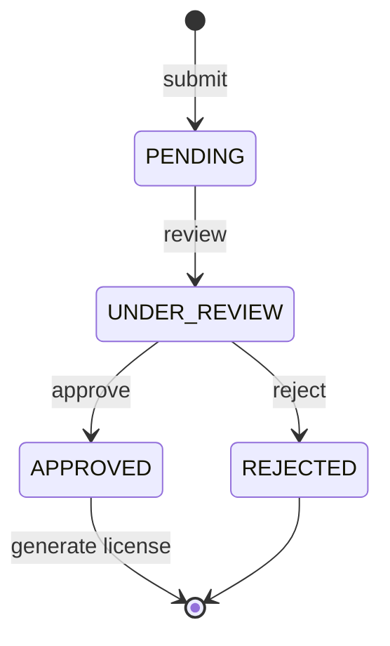
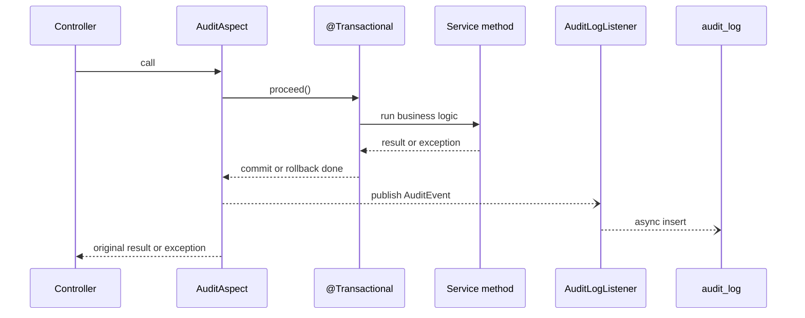
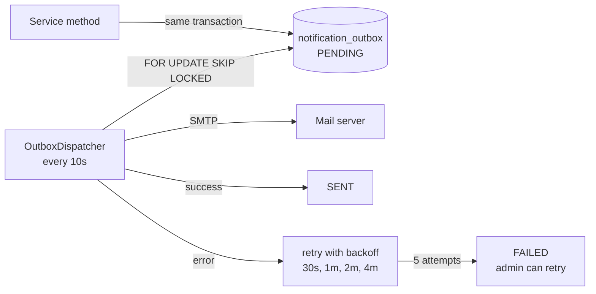

# Hotel & Restaurant Licensing System

A backend for registering hotels, restaurants, lodges and resorts, reviewing their license applications, and issuing, renewing and expiring licenses. Built with **Spring Boot 4** and **Java 21**.

The project focuses on five backend patterns:

- **JWT authentication with roles.** Applicants, reviewers, approvers and admins each get only the actions they need.
- **Rule-driven review workflow.** Applications move through fixed states, and invalid jumps are rejected.
- **Status history.** Every state change is recorded in the same transaction as the change itself.
- **AOP audit logging.** One `@Auditable` annotation records who did what, from where, and whether it succeeded, with no audit code inside business methods.
- **Transactional outbox notifications.** One `@Notify` annotation queues an email in the same transaction as the business change, and a dispatcher sends it with retries.

## Tech stack

| Layer | Technology |
|---|---|
| Language | Java 21 |
| Framework | Spring Boot 4.1 (Web MVC, Data JPA, Validation, Security, Actuator) |
| Auth | Spring Security OAuth2 Resource Server, JWT (HS256), BCrypt |
| AOP | Spring AOP with AspectJ annotations (`spring-boot-starter-aspectj`) |
| Database | PostgreSQL |
| Build | Maven (wrapper included) |
| API testing | Bruno |

## Modules

```
in.wb.nhls
├── business/   Business registration, update, soft delete
├── license/    License applications, review, status history, licenses, renewals
├── payment/    Payment initiation and a mock payment gateway
├── audit/      @Auditable annotation, aspect, async listener, audit log API
├── user/       Users, roles, register/login, JWT issuing, admin user management
├── notification/ @Notify annotation, outbox table, mail dispatcher, admin API
├── config/     Security rules, JWT encoder/decoder, JSON 401/403 responses
└── exception/  Global exception handler (consistent JSON errors)
```

Each module is split into `controller`, `service`, `entity` and `dto` packages, with its own repositories.

## Authentication and roles

Login returns a signed JWT. Send it on every request as `Authorization: Bearer <token>`.

| Role | Can do |
|---|---|
| `APPLICANT` | Register (self sign-up), register businesses, submit applications, renew licenses, pay |
| `REVIEWER` | Move an application to `UNDER_REVIEW` |
| `APPROVER` | `APPROVED` / `REJECTED`, generate licenses |
| `ADMIN` | Create staff users, read audit logs, deactivate businesses, run the expiry job |

- **Two layers of checks.** URL rules in `SecurityConfig` decide who may call an endpoint. Inside the review endpoint, the service also checks which role may set which status, so a reviewer cannot approve and an approver cannot skip the review step.
- **Built-in token handling.** Tokens are validated by Spring Security's resource server (signature, expiry, issuer), not by a hand-written filter.
- **Token claims.** The username is the `sub` claim and the role is in `roles`. Audit logs and status history record the real user automatically.
- **Staff accounts.** Self sign-up always creates an `APPLICANT`. Only an `ADMIN` can create `REVIEWER`, `APPROVER` or `ADMIN` accounts.
- **First admin.** On first start, an admin is created from `ADMIN_USERNAME` / `ADMIN_PASSWORD`. The defaults are `admin` / `Admin@12345`, for local use only.
- **Login hardening.** Failed logins return the same message whether the username exists or not, and take the same time.
- **Consistent errors.** 401 and 403 responses use the same JSON shape as other errors.

### Ownership

Each business is linked to the user who registered it, and applications, licenses and payments inherit that owner through the business.

- An `APPLICANT` sees and changes only their own businesses, applications, licenses and payments. List endpoints return only their own records.
- Accessing someone else's record returns `404`, not `403`, so it is not revealed whether that record exists.
- `REVIEWER`, `APPROVER` and `ADMIN` can see every record.
- All checks use one helper, `CurrentUser.canAccess(owner)`, called from the services.

## Application workflow



- The allowed transitions live in a single `ALLOWED_TRANSITIONS` map in `LicenseApplicationService`.
- Jumping straight from `PENDING` to `APPROVED` returns `400` with the list of allowed next states.
- `APPROVED` and `REJECTED` are final.
- Every successful transition writes a row to `application_status_history`, inside the same transaction.

### License lifecycle

- A license can only be generated for an `APPROVED` application, and only once.
- It is valid for one year. Renewal extends it by another year and records the change in the renewal history.
- A scheduled job runs daily at midnight (`0 0 0 * * *`) and marks overdue `ACTIVE` licenses as `EXPIRED`.

## Audit logging with AOP

Any service method can be audited with one annotation:

```java
@Auditable(action = "APPLICATION_REVIEW", entityType = "LICENSE_APPLICATION",
        entityId = "#applicationNumber",
        detail = "'requested status: ' + #request.applicationStatus()")
@Transactional
public LicenseApplication reviewApplication(String applicationNumber, LicenseApplicationReviewRequest request) {
    // business logic only, no audit code
}
```



**Design decisions**

- **Outside the transaction.** The aspect is ordered before `@Transactional`, so it sees the final outcome.
- **Commit-aware.** `SUCCESS` rows are written only `AFTER_COMMIT`. `FAILURE` rows are written `AFTER_COMPLETION`, so failed attempts are kept even when the transaction rolls back.
- **Non-blocking.** The listener is `@Async`, so audit writes never slow down the API response.
- **Never breaks business logic.** Errors during audit are logged and swallowed. The original exception is always rethrown unchanged.
- **SpEL expressions.** `entityId` and `detail` can read method parameters (`#applicationNumber`) and the return value (`#result?.id`).
- **Trusted client IP.** The client IP comes from `request.getRemoteAddr()`, with `server.forward-headers-strategy=native`, so `X-Forwarded-For` is accepted only from trusted proxies.

Each audit row stores: action, entity type and id, outcome, actor, IP, HTTP method and URI, detail, error message, duration in ms, and timestamp.

Audited operations: business register, update and deactivate; application submit and review; license generate, renew and expire batch; payment initiate and complete.

## Notifications with a transactional outbox

```java
@Notify(template = NotificationTemplate.APPLICATION_STATUS_CHANGED,
        to = "#result.business.email",
        params = "{appNo: #result.applicationNumber, status: #result.applicationStatus, remarks: #result.remarks}")
@Transactional
public LicenseApplication reviewApplication(...) { ... }
```



**Why an outbox?** Sending the email directly inside the request has two failure modes. The email is sent but the transaction rolls back, or the transaction commits but the mail server is down and the email is lost. With an outbox:

- **Atomic with the business change.** The notification row is written in the same transaction. `NotifyAspect` runs inside `@Transactional` (ordering set in `TransactionConfig`), and `NotificationService.enqueue` uses `Propagation.MANDATORY`, so it cannot run outside a transaction by mistake.
- **Nothing is lost.** If the mail server is down, the row stays `PENDING` and is retried with exponential backoff. After 5 attempts it becomes `FAILED`, and an admin can retry it.
- **Safe with many instances.** The dispatcher locks rows with `FOR UPDATE SKIP LOCKED`, so two app instances never send the same email.
- **No email for failed actions.** `@AfterReturning` only fires on success.

Notifications are sent for: application submitted, status changed, license issued, license renewed, and license expired. The expiry notification is queued directly from the batch job.

Locally, [Mailpit](https://mailpit.axllent.org/) catches every email. SMTP runs on `1025` and the web UI on `http://localhost:8025`.

## API

### Auth and users
| Method | Endpoint | Access | Description |
|---|---|---|---|
| POST | `/api/v1/auth/register` | Public | Sign up as an applicant |
| POST | `/api/v1/auth/login` | Public | Get a JWT |
| GET | `/api/v1/auth/me` | Logged in | Current user |
| POST | `/api/v1/users` | ADMIN | Create a user with any role |
| GET | `/api/v1/users` | ADMIN | List users |

### Business
| Method | Endpoint | Description |
|---|---|---|
| POST | `/api/v1/businesses` | Register a business (`HOTEL`, `RESTAURANT`, `LODGE`, `RESORT`) |
| GET | `/api/v1/businesses` | List active businesses |
| GET | `/api/v1/businesses/{id}` | Get one business |
| PUT | `/api/v1/businesses/{id}` | Update a business |
| DELETE | `/api/v1/businesses/{id}` | Soft delete (deactivate) |

### License applications
| Method | Endpoint | Description |
|---|---|---|
| POST | `/api/v1/license-applications` | Submit an application |
| GET | `/api/v1/license-applications/{applicationNumber}` | Get one application |
| PUT | `/api/v1/license-applications/{applicationNumber}/review` | Change status (follows the workflow rules) |
| GET | `/api/v1/license-applications?applicationStatus=PENDING&page=0&size=10` | List by status |
| GET | `/api/v1/license-applications/{applicationNumber}/status-history` | Status timeline |

### Licenses
| Method | Endpoint | Description |
|---|---|---|
| POST | `/api/licenses/generate/{applicationNumber}` | Issue a license for an approved application |
| GET | `/api/licenses/{licenseNumber}` | Get one license |
| GET | `/api/licenses?page=0&size=10` | List licenses |
| POST | `/api/licenses/renew/{licenseNumber}` | Renew for one more year |
| POST | `/api/licenses/expire` | Run the expiry job manually |
| GET | `/api/licenses/{licenseNumber}/renewal-history` | Renewal history |

### Payments
| Method | Endpoint | Description |
|---|---|---|
| POST | `/api/payments/initiate` | Create a pending payment for a license |
| POST | `/api/payments/mock/{transactionReference}?success=true` | Complete or fail a payment (mock gateway) |

### Audit and health
| Method | Endpoint | Description |
|---|---|---|
| GET | `/api/v1/audit-logs` | Search audit logs. Optional filters: `entityType`, `entityId`, `action`, `outcome`, `actor`, `page`, `size` |
| GET | `/api/v1/notifications?status=FAILED` | List outbox notifications (ADMIN) |
| POST | `/api/v1/notifications/{id}/retry` | Retry a failed notification (ADMIN) |
| GET | `/api/v1/health` | Health check |

### Example: status history

```json
[
  { "historyId": 1, "previousStatus": null, "newStatus": "PENDING", "remarks": "আবেদন জমা দেওয়া হয়েছে", "changedBy": "rahim" },
  { "historyId": 2, "previousStatus": "PENDING", "newStatus": "UNDER_REVIEW", "remarks": "Documents checked", "changedBy": "reviewer1" },
  { "historyId": 3, "previousStatus": "UNDER_REVIEW", "newStatus": "APPROVED", "remarks": "All good", "changedBy": "approver1" }
]
```

## Running locally

**Requirements:** Java 21 and PostgreSQL. Optional: Mailpit, to see the emails (`mailpit --listen 127.0.0.1:8025 --smtp 127.0.0.1:1025`).

1. Create the database:
   ```sql
   CREATE DATABASE wb_nhls;
   ```
2. Set the database password. The default is `root`.
   ```bash
   export DB_PASSWORD=your_password
   ```
   On Windows PowerShell: `$env:DB_PASSWORD="your_password"`
3. Run the app. Tables are created automatically on first start.
   ```bash
   ./mvnw spring-boot:run
   ```
   On Windows: `mvnw.cmd spring-boot:run`
4. The API runs at `http://localhost:8080`. Check `GET /api/v1/health`.
5. Log in as the admin, create a reviewer and an approver with `POST /api/v1/users`, then sign up an applicant with `/api/v1/auth/register`.

| Environment variable | Default | Purpose |
|---|---|---|
| `DB_PASSWORD` | `root` | PostgreSQL password |
| `JWT_SECRET` | dev secret | HS256 signing key, at least 32 characters |
| `ADMIN_USERNAME` | `admin` | First admin account |
| `ADMIN_PASSWORD` | `Admin@12345` | First admin password |
| `MAIL_HOST` / `MAIL_PORT` | `localhost` / `1025` | SMTP server for notifications |

Change `JWT_SECRET` and `ADMIN_PASSWORD` before any real deployment.

User-facing error and success messages are in Bengali.

## Roadmap

- [x] JWT authentication with roles (`APPLICANT`, `REVIEWER`, `APPROVER`, `ADMIN`)
- [x] Ownership checks, so applicants see and change only their own businesses and applications
- [x] Notifications through an `@Notify` aspect with an outbox table and retry
- [ ] Observability with Prometheus, Loki and Grafana
- [ ] Workflow transitions stored in the database instead of code
- [ ] Flyway migrations in place of `ddl-auto=update`
- [ ] Integration tests with Testcontainers
