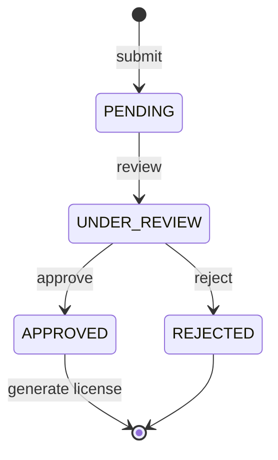
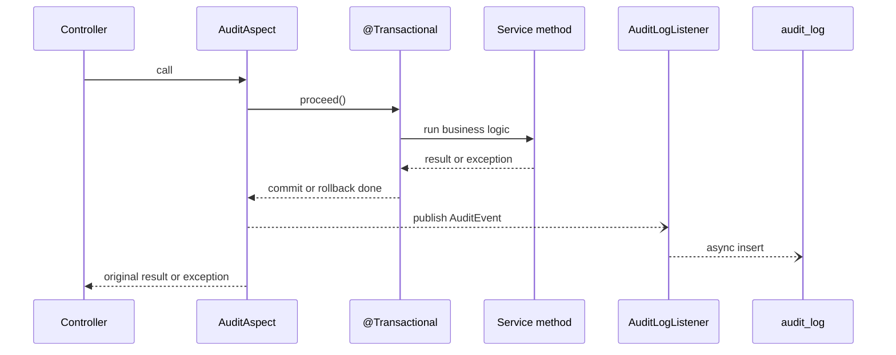

# Hotel & Restaurant Licensing System

A backend for registering hotels, restaurants, lodges and resorts, reviewing their license applications, and issuing, renewing and expiring licenses. Built with **Spring Boot 4** and **Java 21**.

The project focuses on three backend patterns:

- **Rule-driven review workflow.** Applications move through fixed states, and invalid jumps are rejected.
- **Status history.** Every state change is recorded in the same transaction as the change itself.
- **AOP audit logging.** One `@Auditable` annotation records who did what, from where, and whether it succeeded, with no audit code inside business methods.

## Tech stack

| Layer | Technology |
|---|---|
| Language | Java 21 |
| Framework | Spring Boot 4.1 (Web MVC, Data JPA, Validation, Security, Actuator) |
| AOP | Spring AOP with AspectJ annotations (`spring-boot-starter-aspectj`) |
| Database | PostgreSQL |
| Build | Maven (wrapper included) |
| API testing | Bruno |

## Modules

```
in.wb.nhls
├── business/   Business registration, update, soft delete
├── license/    License applications, review, status history, licenses, renewals
├── payment/    Payment initiation and a mock payment gateway
├── audit/      @Auditable annotation, aspect, async listener, audit log API
├── config/     Security configuration
└── exception/  Global exception handler (consistent JSON errors)
```

Each module is split into `controller`, `service`, `entity` and `dto` packages, with its own repositories.

## Application workflow



- The allowed transitions live in a single `ALLOWED_TRANSITIONS` map in `LicenseApplicationService`.
- Jumping straight from `PENDING` to `APPROVED` returns `400` with the list of allowed next states.
- `APPROVED` and `REJECTED` are final.
- Every successful transition writes a row to `application_status_history`, inside the same transaction.

### License lifecycle

- A license can only be generated for an `APPROVED` application, and only once.
- It is valid for one year. Renewal extends it by another year and records the change in the renewal history.
- A scheduled job runs daily at midnight (`0 0 0 * * *`) and marks overdue `ACTIVE` licenses as `EXPIRED`.

## Audit logging with AOP

Any service method can be audited with one annotation:

```java
@Auditable(action = "APPLICATION_REVIEW", entityType = "LICENSE_APPLICATION",
        entityId = "#applicationNumber",
        detail = "'requested status: ' + #request.applicationStatus()")
@Transactional
public LicenseApplication reviewApplication(String applicationNumber, LicenseApplicationReviewRequest request) {
    // business logic only, no audit code
}
```



**Design decisions**

- **Outside the transaction.** The aspect is ordered before `@Transactional`, so it sees the final outcome.
- **Commit-aware.** `SUCCESS` rows are written only `AFTER_COMMIT`. `FAILURE` rows are written `AFTER_COMPLETION`, so failed attempts are kept even when the transaction rolls back.
- **Non-blocking.** The listener is `@Async`, so audit writes never slow down the API response.
- **Never breaks business logic.** Errors during audit are logged and swallowed. The original exception is always rethrown unchanged.
- **SpEL expressions.** `entityId` and `detail` can read method parameters (`#applicationNumber`) and the return value (`#result?.id`).
- **Trusted client IP.** The client IP comes from `request.getRemoteAddr()`, with `server.forward-headers-strategy=native`, so `X-Forwarded-For` is accepted only from trusted proxies.

Each audit row stores: action, entity type and id, outcome, actor, IP, HTTP method and URI, detail, error message, duration in ms, and timestamp.

Audited operations: business register, update and deactivate; application submit and review; license generate, renew and expire batch; payment initiate and complete.

## API

### Business
| Method | Endpoint | Description |
|---|---|---|
| POST | `/api/v1/businesses` | Register a business (`HOTEL`, `RESTAURANT`, `LODGE`, `RESORT`) |
| GET | `/api/v1/businesses` | List active businesses |
| GET | `/api/v1/businesses/{id}` | Get one business |
| PUT | `/api/v1/businesses/{id}` | Update a business |
| DELETE | `/api/v1/businesses/{id}` | Soft delete (deactivate) |

### License applications
| Method | Endpoint | Description |
|---|---|---|
| POST | `/api/v1/license-applications` | Submit an application |
| GET | `/api/v1/license-applications/{applicationNumber}` | Get one application |
| PUT | `/api/v1/license-applications/{applicationNumber}/review` | Change status (follows the workflow rules) |
| GET | `/api/v1/license-applications?applicationStatus=PENDING&page=0&size=10` | List by status |
| GET | `/api/v1/license-applications/{applicationNumber}/status-history` | Status timeline |

### Licenses
| Method | Endpoint | Description |
|---|---|---|
| POST | `/api/licenses/generate/{applicationNumber}` | Issue a license for an approved application |
| GET | `/api/licenses/{licenseNumber}` | Get one license |
| GET | `/api/licenses?page=0&size=10` | List licenses |
| POST | `/api/licenses/renew/{licenseNumber}` | Renew for one more year |
| POST | `/api/licenses/expire` | Run the expiry job manually |
| GET | `/api/licenses/{licenseNumber}/renewal-history` | Renewal history |

### Payments
| Method | Endpoint | Description |
|---|---|---|
| POST | `/api/payments/initiate` | Create a pending payment for a license |
| POST | `/api/payments/mock/{transactionReference}?success=true` | Complete or fail a payment (mock gateway) |

### Audit and health
| Method | Endpoint | Description |
|---|---|---|
| GET | `/api/v1/audit-logs` | Search audit logs. Optional filters: `entityType`, `entityId`, `action`, `outcome`, `actor`, `page`, `size` |
| GET | `/api/v1/health` | Health check |

### Example: status history

```json
[
  { "historyId": 1, "previousStatus": null, "newStatus": "PENDING", "remarks": "আবেদন জমা দেওয়া হয়েছে" },
  { "historyId": 2, "previousStatus": "PENDING", "newStatus": "UNDER_REVIEW", "remarks": "Documents received" },
  { "historyId": 3, "previousStatus": "UNDER_REVIEW", "newStatus": "APPROVED", "remarks": "It is approved" }
]
```

## Running locally

**Requirements:** Java 21 and PostgreSQL.

1. Create the database:
   ```sql
   CREATE DATABASE wb_nhls;
   ```
2. Set the database password. The default is `root`.
   ```bash
   export DB_PASSWORD=your_password
   ```
   On Windows PowerShell: `$env:DB_PASSWORD="your_password"`
3. Run the app. Tables are created automatically on first start.
   ```bash
   ./mvnw spring-boot:run
   ```
   On Windows: `mvnw.cmd spring-boot:run`
4. The API runs at `http://localhost:8080`. Check `GET /api/v1/health`.

User-facing error and success messages are in Bengali.

## Roadmap

- [ ] JWT authentication with roles (`APPLICANT`, `REVIEWER`, `APPROVER`, `ADMIN`)
- [ ] Notifications through an `@Notify` aspect with an outbox table and retry
- [ ] Observability with Prometheus, Loki and Grafana
- [ ] Workflow transitions stored in the database instead of code
- [ ] Flyway migrations in place of `ddl-auto=update`
- [ ] Integration tests with Testcontainers
